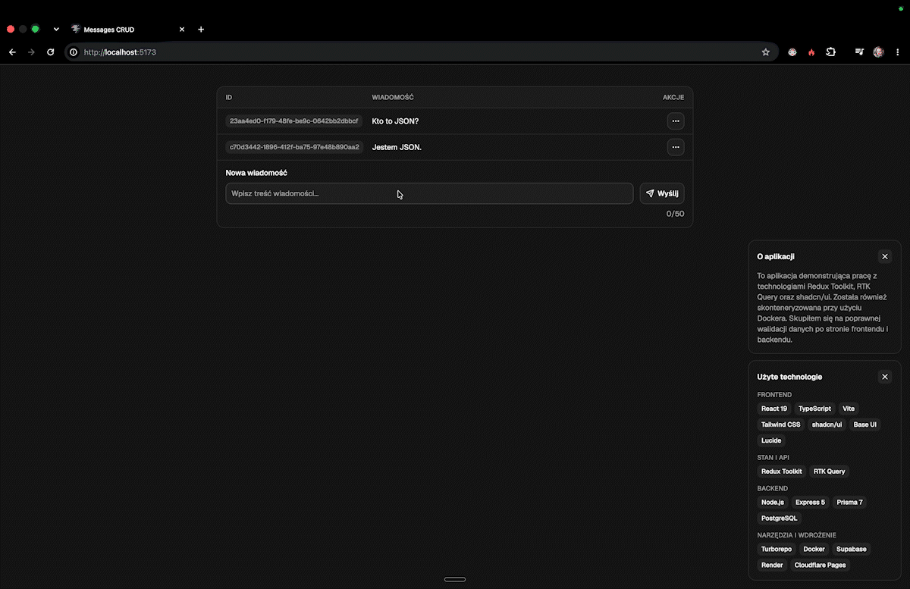

# Wiadomości: full-stack CRUD app

Create, edit and delete short messages. Small on purpose: the point is the engineering around it, from validation and tests to CI and deployment.

**[Live demo](https://wiadomosci.wujecdamian.dev)** · API: `https://api-wiadomosci.wujecdamian.dev/health`

## Stack

| Layer    | Tech                                                      | Hosted on        |
| -------- | --------------------------------------------------------- | ---------------- |
| Frontend | React 19, TypeScript, Vite, Redux Toolkit (RTK Query), Tailwind, shadcn/ui | Cloudflare Pages |
| Backend  | Node.js, Express 5, TypeScript                            | Render (Docker)  |
| Database | PostgreSQL, Prisma 7 with migrations                      | Supabase         |
| Quality  | Vitest, Supertest, ESLint, GitHub Actions                 | GitHub           |

Monorepo with a shared UI package. Docker Compose runs the whole stack locally.

## What's in it

- **REST API** (`GET/POST /api/messages`, `PATCH/DELETE /api/messages/:id`) with correct status codes: `400` invalid input, `404` unknown id, `500` database failure, `204` on delete.
- **Input validated at the boundary:** content is trimmed and length-checked, ids must be UUIDs. SQL injection is handled by Prisma's parameterized queries, not by the validation.
- **Hardening:** CORS allow-list, 10 kB request body limit, central error handler that never leaks internals.
- **Frontend UX:** RTK Query caching and invalidation, loading and error states with retry, confirmation before delete, inline form errors.
- **Deployed end to end:** pushes to `main` redeploy the API and the frontend automatically.

## Testing and CI

- **44 server tests** (Vitest + Supertest, about 91% line coverage): validation edge cases (boundary lengths, trim-before-length, non-string input) and every branch of every endpoint, plus CORS, payload limit and malformed JSON.
- The database is mocked, so the tests check the API's logic and HTTP contract, not real SQL.
- **GitHub Actions** runs on every push and PR: server typecheck and tests, client lint, typecheck and build. `main` is protected, so merges need green checks.
- `app.ts` (the Express app) is separate from `index.ts` (starts the server), so tests import the app without opening a port.
